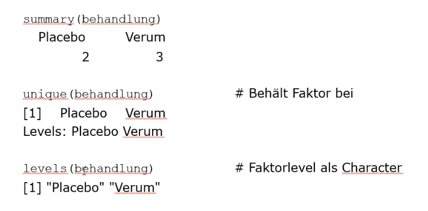

# 2026-10-13

```{r}
behandlung <- rep(c("Placebo", "Verum"), c(2,3))

summary(behandlung)

```

```{r}
behandlung <- factor(behandlung)
summary(behandlung)
```

```{r}
str(behandlung)
```

{fig-align="center" width="413"}

```{r}
zustand <- ordered(c("Gut","Schlecht","Super","Super","Frag nicht","Gut"), levels = c("Frag nicht", "Schlecht", "Gut", "Super"))
zustand
```

```{r}
alter <- c(25, 30, 42, 18, 55, 60, 22, 37, 28, 48)
grenzen <- c(0, 20, 30, 40, 50, 100)
alter_faktor <- cut(alter, breaks = grenzen, labels = c("0-20", "21-30", "31-40", "41-50", "51+"), ordered = TRUE)
alter_faktor
```

```{r}
data(iris)
class(iris)
head(iris)
```

```{r}

data <- read.csv2("R:\\GitHub\\Zoes-Hagenberg-3-The-Hagening\\Statistics\\Data\\babydaten.csv")

head(data)
```

```{r}
source("..//Data//packages.R")
```

```{r}
library(tidyverse)
library(DescTools)
library(data.table)
library(plyr)
library(microbenchmark)
library(psych)

data2 <- read_excel("..\\data\\Babydaten.xlsx", sheet="Babydaten") # excel sucks anyways
head(data2)
```

```{r}
iris$Sepal.Width

data[1:4, c("Gewicht", "Größe")]
```

```{r}

iris[iris$Species == "setosa", "Sepal.Width"]

any(iris$Sepal.Width < 2.4)

```

```{r}

subset(iris, Species=="setosa")

subset(iris, Species=="setosa", select=-5)


subset(iris, Species %in% c("setosa", "virginica") & Sepal.Width<2.4)

LSpecies <- split(iris, iris$Species)
LSpecies

LSpecies$setosa

```

```{r}

apply(X = cars, MARGIN = 2, FUN = max)

apply(cars, 2, quantile, 0.25)


```

```{r}

span <- function(x)
  { 
    return(max(x)-min(x)) 
  } 

apply(cars, 2, span)
```
