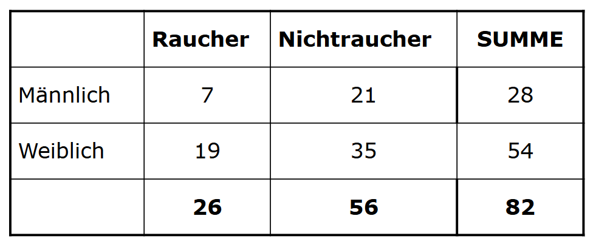

# Bivariate Statistik

```{r clear memory}
rm(list=ls())
```

## Correlations

### Ex. 1

> Gibt es einen Zusammenhang zwischen den Energieeffizienzklassen und dem Gerätepreis?

Ja, umso schlechter die Energie-Klasse, umso kleiner der Preis.

> Berechnen Sie den geeigneten Korrelationskoeffizienten?

Kendall, da kleiner Datensatz.

```{r}

E <- factor(c("A","C","C","D","G","E","E","F","A","B","B","F","C","G"))
P <- c(56,45,51,47,23,26,36,37,53,50,54,25,40,34)

cor(P, as.numeric(E), method = "kendall")

```

### Ex. 2

Both are 0.8! Yippie!

```{r}
x <- c(4, 7, 6, 5, 8)
y <- c(5, 6, 7, 4, 8)

manual <- 1 - ( (6 * sum((y - x)^2)) / (length(x) * (length(x)^2 - 1)))
manual

cor(x, y, method="spearman")

```

### Ex. 3



```{r}
library(vcd)

table <- matrix(c(c(7, 19), c(21, 35)), nrow = 2, ncol = 2, dimnames = list(c("male", "female"), c("smoker", "non-smoker")))

assocstats(table)

```

## Linear Regression

### Ex. 1

```{r}
library(ggplot2)
library(caTools)

ice <- data.frame(temperatur = c(14,16,18,19,21,22,24,25,27,29,31), anzahl = c(42,48,55,61,67,72,81,85,94,105,119))

lm_r = lm(formula = ice$anzahl ~ ice$temperatur)
summary(lm_r)
```

```{r}
coefs <-  coef(lm_r)
coefs
```

Gleichung: y = 4.435364 x - 23.827222 R2 = 0.9879

```{r}
func <- function(x)
{
  return (4.435364 * x + -23.8272222)
}


func(23)

```

Erwartet: 78.1

```{r}

ggplot() +
geom_point(aes(x = ice$temperatur, y = ice$anzahl), colour = 'red') +
geom_line(aes(x = ice$temperatur, y = predict(lm_r, newdata = ice)), colour = 'blue') +
ggtitle('Ice') +
xlab('Temparture') + 
ylab('Amount')

```

### Ex. 2

```{r}
data("mtcars")

head(mtcars)

```

```{r}

lm_r = lm(formula = mtcars$mpg ~ mtcars$wt, data = ice)
summary(lm_r)

```

```{r}
ggplot() +
geom_point(aes(x = mtcars$wt, y = mtcars$mpg), colour = 'red') +
geom_line(aes(x = mtcars$wt, y = predict(lm_r, newdata = mtcars)), colour = 'blue') +
ggtitle('cars') +
xlab('weight') + 
ylab('mpg')

```

### Ex. 3

#### Cholesterin

```{r}
chol <- readxl::read_xlsx("../../Data/Cholesterin.xlsx")

chol <- chol[c(1, 2)]

chol <- na.omit(chol)

head(chol)

summary(chol)

```

``` {r}

lm_r <- lm(chol$`HDL [mg/dl]` ~ chol$`Systole [mm Hg]`)


summary(lm_r)

```

#### Baby

```{r}
baby <- readxl::read_xlsx("../../Data/Babydaten1.xlsx")

baby <- na.omit(baby)

head(baby)

summary(baby)

```

```{r}

a <- (as.numeric(factor(baby$Sectio)) - 1 ) * -1 + 1 # makes 0 no sectio and 1 sectio to make the correlation make more sense

cor(baby$KH_Aufenthalt, a, method = "kendall")

lm_r <- lm(formula = baby$KH_Aufenthalt ~ baby$Sectio)
summary(lm_r)

```

## Logistic Regression

``` {r}
film_data <- read.csv2("../../Data/film.csv")

head(film_data)

```

``` {r}

logistic_model <- glm(film_data$Gefallen~film_data$Alter, data=film_data, family="binomial")

summary(logistic_model)

```

``` {r}
coef(logistic_model)

exp(coef(logistic_model))
```

``` {r}

predicted_data <- data.frame(
  Alter = seq(min(film_data$Alter), max(film_data$Alter), length.out = 40)
)
predicted_data$Gefallen <- predict(logistic_model, newdata = predicted_data, type = "response")

plot(Gefallen ~ film_data$Alter, data = film_data,
     xlab = "Alter", ylab = "P(Gefallen = 1)",
     ylim = c(0, 1), pch = 16)
lines(Gefallen ~ Alter, data = predicted_data, lwd = 2, col = "green")

```