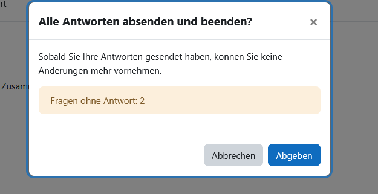

## Imports

```{r data}

library(datasets)
library(dplyr)
library(ggplot2)

```

## Ozone and Wind

```{r Ozone}
sapply(split(airquality[, c("Ozone", "Wind")], airquality$Month), colMeans, na.rm = TRUE)
```

## aggregration

### median and mean of Price / Cut

```{r agg}

func <- function(x) {c(MW=mean(x), MEDIAN=median(x))}

a <- aggregate(price ~ cut, diamonds, func)

a <- do.call(data.frame, a)

a

```

### median of cut / color

```{r agg2}

a <- aggregate(x = diamonds$price, by=list(diamonds$cut, diamonds$color), func)

a <- do.call(data.frame, a)

a
```

### carats

```{r agg3}

# i found out you can just do it this way lol 

a <- aggregate(carat ~ cut, data = diamonds, FUN = func)
a <- do.call(data.frame, a)
a

b <- aggregate(carat ~ cut + color, data = diamonds, FUN = func)
b <- do.call(data.frame, b)
b

```

## Extra

A little confused why it didn't register the answers. Here's proof I did it in case Moodle is not working.

{width="327"}](images/clipboard-4200109938.png){width="326"}
